# Q2 (e) — Complete pipeline flow

```mermaid
flowchart LR
    subgraph DEV["1 · Code / Data"]
        A1["src/*.py · api/ · params.yaml"]
        A2["data/raw/iris.csv"]
    end

    subgraph VC["2 · Git + DVC"]
        B1["Git (GitHub)<br/>code, dvc.yaml, dvc.lock,<br/>params.yaml, metrics.json"]
        B2["DVC remote<br/>dataset + model cache"]
    end

    subgraph CI["3 · CI — GitHub Actions"]
        C1["PR → cml.yaml<br/>dvc repro → metrics/params diff<br/>→ CML comment on PR"]
        C2["push to main → cicd.yaml<br/>dvc repro → quality gate → pytest"]
    end

    subgraph PKG["4 · Package"]
        D1["MLflow<br/>log params/metrics,<br/>register 'iris-classifier'"]
        D2["Docker build<br/>FastAPI + model.joblib"]
    end

    E["5 · Registry<br/>ghcr.io/&lt;owner&gt;/mlops-iris-pipeline:&lt;commit-sha&gt;"]

    subgraph K8S["6 · Kubernetes"]
        F1["kubectl set image"]
        F2["rollout status ✓<br/>smoke test /health /predict"]
        F3["rollout undo ✗"]
        F4["Deployment (3 replicas, probes)<br/>Service · HPA 3–10"]
    end

    A1 -->|git commit/push| B1
    A2 -->|dvc add / dvc push| B2
    B1 --> C1
    B1 --> C2
    B2 -. dvc pull .-> C1
    B2 -. dvc pull .-> C2
    C1 -->|review + merge| C2
    C2 --> D1 --> D2
    D2 -->|docker push| E
    E --> F1 --> F2 --> F4
    F2 -->|failure| F3 --> F4
```



## Plain-text version

```
 Code / Data ──git push──► GitHub ──PR──► CI (CML): dvc repro → metrics diff → PR comment
      │                       │                         │ merge
  dvc add/push                │                         ▼
      ▼                       └──push main──► CI: dvc repro → quality gate → pytest
  DVC remote ◄──dvc pull────────────────────────────────┘
                                                        ▼
                               MLflow (log + register) → Docker build (tag = commit SHA)
                                                        ▼
                                          Registry: ghcr.io/<owner>/<repo>:<sha>
                                                        ▼
                    Kubernetes: kubectl set image → rollout status → smoke test
                                 ├─ success → Deployment (3 pods) + Service + HPA
                                 └─ failure → kubectl rollout undo
```
